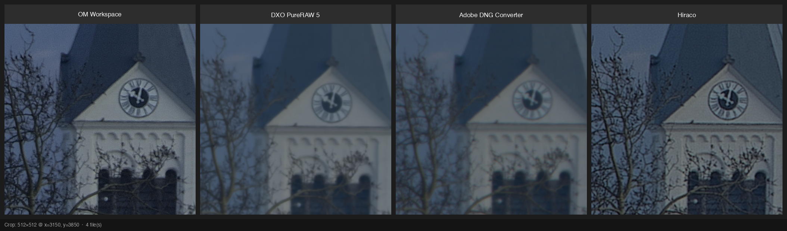
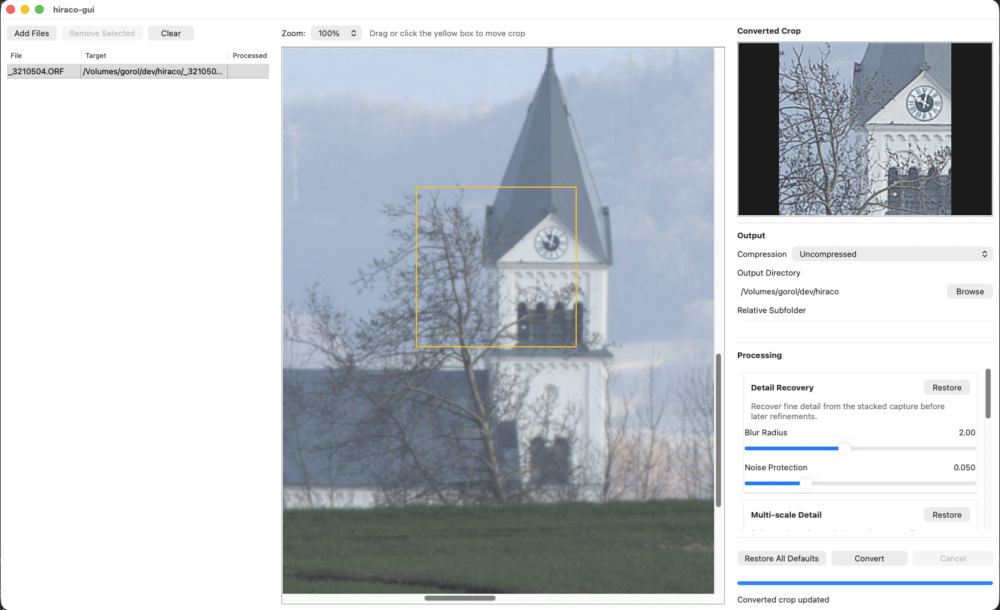

# hiraco

`hiraco` is a native C++ toolchain for converting selected Olympus / OM SYSTEM RAW files, with a custom emphasis on high-resolution sensor-shift captures, into rendered Linear DNG files.

The repository builds one shared processing core and exposes it through native and browser-oriented targets:
- `hiraco-cli` for the full desktop command-line conversion pipeline
- `hiraco-gui` for interactive preview, tuning, and batch conversion
- `hiraco-wasm` (experimental) for the browser-facing conversion module

The current implementation supports both a custom high-resolution raw-domain reconstruction path and a LibRaw-based render path for other supported inputs. The native desktop stack remains the default. The WebAssembly build carries the *same* conversion core: the DNG SDK writer, the image processing stages and the RAW decoder are all compiled for WebAssembly, so `hiraco-cli.js` really converts ORF and ORI files. The two builds do not produce bit-identical files, because aarch64 contracts `a * b + c` into a fused multiply-add and WebAssembly has no such instruction; see `docs/wasm-verification.md` for the measured difference.

## GUI



## What The Project Currently Provides

- `hiraco-core`: shared static library containing preparation, metadata, preview, full-preview, enhancement, and DNG writing code.
- `hiraco-cli`: command-line `convert` frontend.
- `hiraco-gui`: wxWidgets desktop frontend with thumbnail queueing, full-frame comparison, output controls, and conversion.
- `hiraco-wasm`: experimental browser target built with Emscripten; the GUI is intentionally excluded, and the module carries the same conversion core as the native build and converts RAW buffers into DNG buffers.
- Custom high-resolution raw-domain reconstruction driven by vendor metadata and stack-guidance maps.
- Optional, per-file ORI-assisted highlight recovery for supported high-resolution
  ORFs when a same-directory companion candidate is detected.  The correction is
  disabled by default and is subtractive: it preserves high-resolution detail
  while borrowing only a lower highlight base from the companion.
- Rendered Linear DNG output with `uncompressed`, `deflate`, and `jpeg-xl` compression modes.
- Three user-facing processing control groups in the GUI:
  - `Detail Recovery`
  - `Multi-scale Detail`
  - `Edge Refinement`
- Cached original previews, full-resolution processing data, and display-resolution processing derivatives for responsive converted full-image inspection in the GUI.
- Optional timing output for performance work via `--debug` or `HIRACO_TIMING=1`.

## Supported Workflows

- Convert `.ORF` and `.ORI` sources to rendered Linear DNG.
- Open the GUI, inspect full-frame original and converted previews in original,
  converted, or side-by-side comparison modes.
- Pan and zoom the comparison view while adjusting processing controls.
- Queue multiple files, choose a specific folder, the source folder, or a source
  subfolder, and batch convert them.

The strongest custom path in the repository today is the high-resolution workflow. Standard sources still go through the shared core, but the specialized raw-domain reconstruction is targeted at the  high-resolution capture format.

## Requirements

`hiraco` currently expects:

- CMake 3.28+
- LibRaw
- FFTW3 and `fftw3_threads`
- Halide
- Zlib
- Boost headers (required by the Adobe XMP toolkit bundled with the DNG SDK)
- OpenMP (optional but strongly recommended)
- wxWidgets (for `hiraco-gui`)
- Emscripten toolchain (for `hiraco-wasm`)
- Adobe DNG SDK 1.7.1 bundle unpacked into `dng_sdk_1_7_1/`

The repository also expects the bundled Adobe libjxl and XMP toolkit that ship with the DNG SDK bundle under `dng_sdk_1_7_1/`.

### macOS

```bash
brew install cmake libraw fftw halide libomp pkg-config wxwidgets
```

### Linux (Debian/Ubuntu)

```bash
sudo apt update
sudo apt install build-essential cmake libraw-dev libfftw3-dev libhalide-dev libomp-dev pkg-config zlib1g-dev libwxgtk3.2-dev
```

### Windows (vcpkg)

```powershell
vcpkg install boost libraw fftw3 halide zlib wxwidgets:x64-windows
```

### WebAssembly (Emscripten)

For the browser target, install the Emscripten toolchain and the Halide host
tool first:

```bash
brew install emscripten
# Halide is a host tool: its generator runs on the build machine and emits
# the WebAssembly pipeline code.
brew install halide
# or follow the official emsdk install flow if you prefer managing a specific version
```

After installation, configure the browser build with `emcmake` as shown below.

## Building

### Configure And Build

#### Native build (default)

```bash
cmake --preset release
cmake --build --preset release
```

This produces:

- `build/release/hiraco-cli`
- `build/release/hiraco-gui`
- `build/release/libhiraco-core.a`

#### WebAssembly target (experimental)

```bash
# install Emscripten and the Halide host tool first, then:
./scripts/build_wasm.sh
```

The script configures the `wasm` CMake preset and builds the WebAssembly
targets.  It finds the Emscripten toolchain file from `emcc`; set
`EMSCRIPTEN_TOOLCHAIN_FILE` to override that.  The equivalent explicit
invocation is:

```bash
emcmake cmake -S . -B build-wasm -DHIRACO_BUILD_WASM=ON -DHIRACO_BUILD_GUI=OFF -DHIRACO_BUILD_TESTS=ON
cmake --build build-wasm --target hiraco-cli hiraco-wasm
```

This produces:

- `build-wasm/hiraco-cli.js` and `build-wasm/hiraco-cli.wasm`, the command line converter running under Node
- `build-wasm/hiraco-wasm.js` and `build-wasm/hiraco-wasm.wasm`, the browser module

The WebAssembly build needs a host installation of Halide, because the Halide
generator runs on the build machine and emits the WebAssembly pipeline code.
Point CMake at it with `-DHIRACO_HALIDE_DIR=/path/to/lib/cmake/Halide` if it
is not found automatically.

Two dependencies are built from source for the WebAssembly target, because
neither has a WebAssembly build:

- **FFTW3** is fetched, checksummed and compiled with its generic codelets.
- **LibRaw** is fetched, checksummed and compiled against the Emscripten zlib
  and libjpeg ports.

The native build keeps using the system FFTW and LibRaw, which are built with
SIMD and OpenMP and are therefore faster.  `HIRACO_USE_BUNDLED_FFTW` and
`HIRACO_USE_BUNDLED_LIBRAW` switch the native build over to the same source
builds the WebAssembly target uses.

The WebAssembly target is 64 bit.  A 10386 x 7792 sensor-shift capture peaks at
about 8 GB of resident memory in the native build, which does not fit in the
4 GB address space of a 32 bit WebAssembly module.

If `wx-config` is not on `PATH` on macOS, point CMake at it explicitly:

```bash
cmake --preset release \
  -DwxWidgets_CONFIG_EXECUTABLE="$(brew --prefix wxwidgets)/bin/wx-config"
cmake --build --preset release
```

### Useful Build Switches

```bash
cmake -S . -B build -DHIRACO_BUILD_GUI=OFF
cmake -S . -B build -DHIRACO_BUILD_CLI=OFF
cmake -S . -B build -DHIRACO_BUILD_TESTS=ON

# WebAssembly / browser build
./scripts/build_wasm.sh
```

## Running

### CLI

The CLI currently exposes one command:

```bash
./build/release/hiraco-cli convert <source> <output> [--compression uncompressed|deflate|jpeg-xl] [--hl-rec] [--debug]
```

The WebAssembly build takes the same arguments and really converts the file:

```bash
node build-wasm/hiraco-cli.js convert sample/_3210505.ORF output.dng --compression deflate --debug
```

Examples:

```bash
./build/release/hiraco-cli convert _3210505.ORF output.dng --compression uncompressed
./build/release/hiraco-cli convert _3210505.ORF output.dng --compression deflate
./build/release/hiraco-cli convert _3210505.ORI output.dng --compression jpeg-xl --debug
./build/release/hiraco-cli convert _3210505.ORF output.dng --hl-rec
```

`--debug` enables timing logs for the main processing phases.  `--hl-rec`
enables ORI-assisted highlight recovery when a companion file is detected next to
the source; it is off by default and has no effect when no companion is found.

The WebAssembly build does not find a companion file, because the conversion
runs on a buffer rather than on a directory, so `--hl-rec` has no effect there.

The WebAssembly build is slower than the native one - roughly twice as long on
a 5220 x 3912 capture - because its FFTW has no SIMD codelets and the
demosaic runs without OpenMP.

The browser module takes the RAW data as a buffer and returns the DNG as a
buffer, so a page never needs a file system:

```js
const createModule = await import('./build-wasm/hiraco-wasm.js');
const module = await createModule();
// ... fill the heap with the RAW data, call _hiraco_wasm_convert, read the
// DNG back out of the heap.  See tests/wasm_convert_harness.js.
```

### GUI

```bash
./build/release/hiraco-gui
```

The GUI currently supports:

- Adding files with a button or drag-and-drop
- Persistent thumbnail queue with per-file removal and processed-state feedback
- Full-frame original/converted comparison with `Original`, `Converted`, and
  synchronized `Side by side` modes
- `Fit`, `50%`, and `100%` zoom modes, plus direct panning when zoomed
- `Small`, `Medium`, and `Strong` processing presets alongside direct controls
- Compression plus expandable output options for a specific folder, next to the
  source ORF, or a subfolder under it
- Interactive processing controls for detail recovery, multi-scale detail, and edge refinement
- Per-file `HL Rec` switch when a high-resolution ORF has a detected companion
  candidate; it is off by default
- Overwrite prompts, progress reporting, and cancellation

## Tests

If tests are enabled, the repository builds `hiraco-core-tests`:

```bash
cmake --preset relwithdebinfo -DHIRACO_BUILD_TESTS=ON
cmake --build --preset relwithdebinfo --target hiraco-core-tests
ctest --test-dir build/relwithdebinfo --output-on-failure
```

The test target currently covers core-library behavior rather than full GUI automation.

### Verifying the WebAssembly build

The WebAssembly build is checked against the native build with three tools:

```bash
# the DNG capability summaries must describe the running build
./build-wasm/hiraco-capability-check.js

# the two Halide pipelines must agree to the last floating point bit
.venv/bin/python scripts/compare_halide_pipelines.py \
    build-native/hiraco-halide-check build-wasm/hiraco-halide-check.js

# convert every fixture with both builds and compare the DNGs
.venv/bin/python scripts/verify_wasm.py \
    --native build-native/hiraco-cli --wasm build-wasm/hiraco-cli.js
```

`docs/wasm-verification.md` describes how the comparison works and how the
tolerance between the two builds was established.

## Processing Notes

At a high level, the current pipeline is:

1. Inspect the source with LibRaw and build reusable base metadata.
2. Lazily enrich that metadata with vendor MakerNote and stack-guidance data when needed.
3. Render either:
   - a cached original preview,
   - a cached converted full-image preview, or
   - a full rendered Linear DNG payload.
4. Apply enhancement stages when the source metadata requests predicted detail gain.
5. Optionally apply ORI-assisted highlight recovery for an enabled, detected
   companion.
6. Package the final rendered image through the Adobe DNG SDK.

Companion detection is currently filename-based only; it does not verify that the
ORI/ORF pair belongs to the same capture.  Enable `HL Rec` only for known matching
pairs.  See [algorithm.md](algorithm.md) for the implementation details and current
limitations.

## Legal Disclaimer

*OM SYSTEM and Olympus are registered trademarks of OM Digital Solutions Corporation or Olympus Corporation. This project is not affiliated with, endorsed by, or sponsored by these companies. All trademarks are used only for compatibility description and nominative fair use purposes.*
